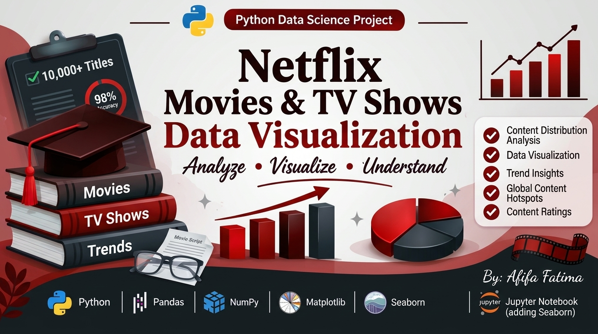
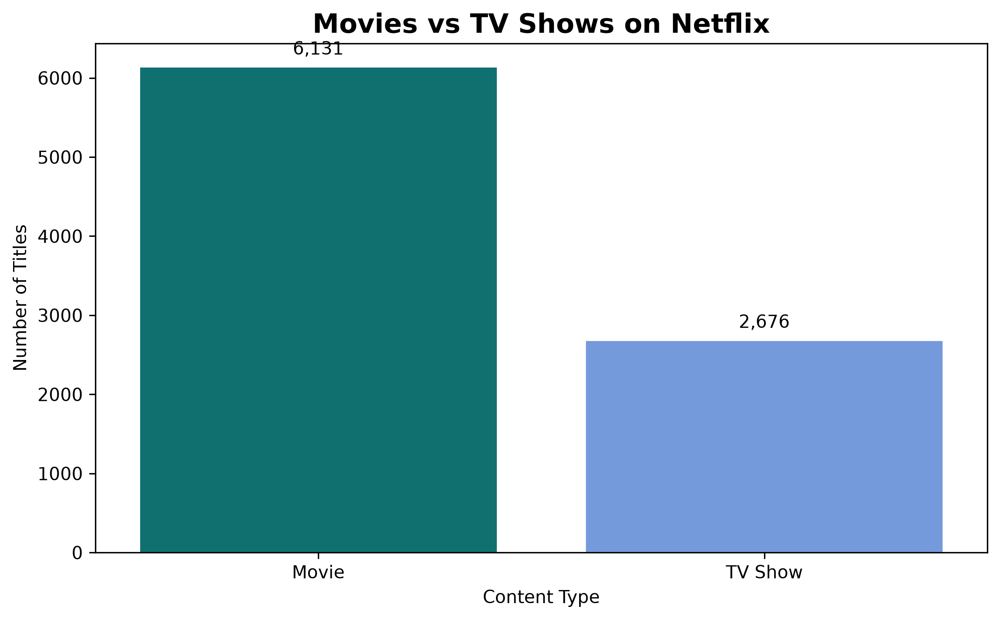
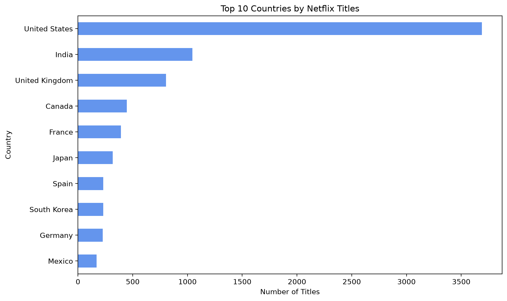
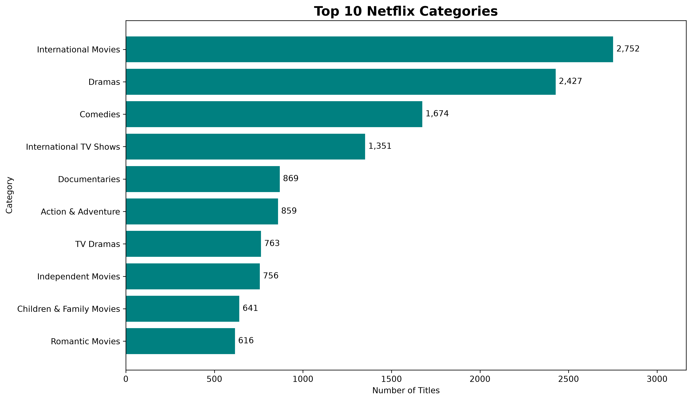
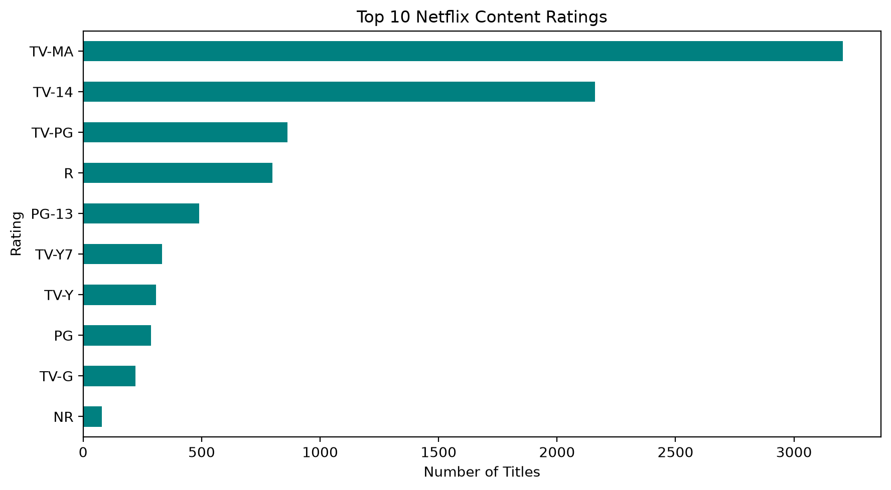
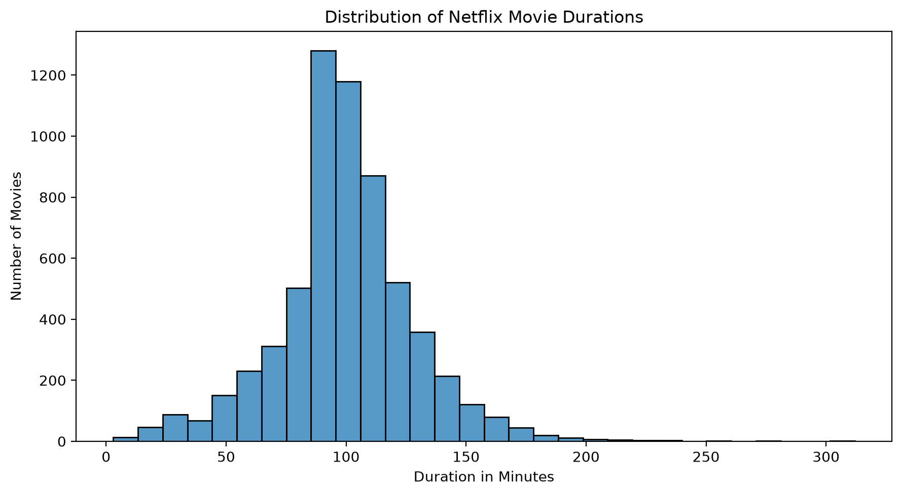
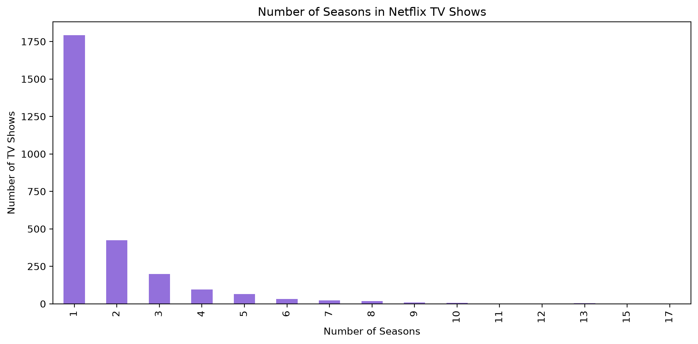
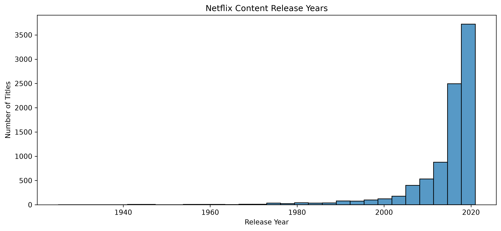
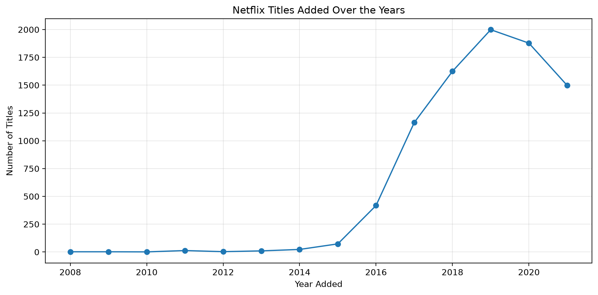

# 🎬 Netflix Data Visualization Project



## 📌 Project Overview

This project explores Netflix Movies and TV Shows data using Python. The main goal is to analyze Netflix content, discover interesting patterns, and present meaningful insights through professional visualizations.

## 🎯 Project Objectives

- Analyze Movies and TV Shows available on Netflix.
- Explore content distribution by release year.
- Identify the most popular content categories.
- Analyze top countries producing Netflix content.
- Explore ratings and movie durations.
- Understand TV show seasons distribution.
- Create meaningful data visualizations.

## 🛠️ Tools & Technologies

- Python
- Pandas
- NumPy
- Matplotlib
- Seaborn
- Jupyter Notebook

## 📊 Data Visualizations

### 1. Movies vs TV Shows


### 2. Top 10 Countries


### 3. Top 10 Categories


### 4. Top 10 Ratings


### 5. Movie Duration Distribution


### 6. TV Show Seasons


### 7. Release Years


### 8. Titles Added by Year


## 📁 Project Structure

- `netflix_data_visualization.ipynb` — Main analysis notebook.
- `netflix_titles (1).csv` — Original dataset.
- `netflix_titles_cleaned.csv` — Cleaned dataset.
- `netflix_analysis_summary.csv` — Analysis summary.
- `requirements.txt` — Required Python libraries.
- `.png` files — Data visualization charts.

## 🔍 Key Analysis Areas

- Content type distribution
- Country-wise content analysis
- Genre and category exploration
- Netflix ratings analysis
- Movie duration patterns
- TV show seasons analysis
- Year-wise content trends

## 🚀 How to Run

1. Download or clone this repository.
2. Install the required libraries:

```bash
pip install -r requirements.txt
```

3. Open the Jupyter Notebook:

```bash
jupyter notebook netflix_data_visualization.ipynb
```

4. Run the notebook cells to explore the analysis.

## 📌 Conclusion

This project demonstrates how Python can be used to explore, clean, analyze, and visualize real-world entertainment data. It provides useful insights into Netflix's content distribution and trends.

## 👩‍💻 Author

**Afifa Fatima**

Aspiring Data Scientist | Python Learner | Data Analytics Enthusiast

[GitHub Profile](https://github.com/afifatima52-blip)

---

⭐ If you find this project interesting, consider giving it a star!

