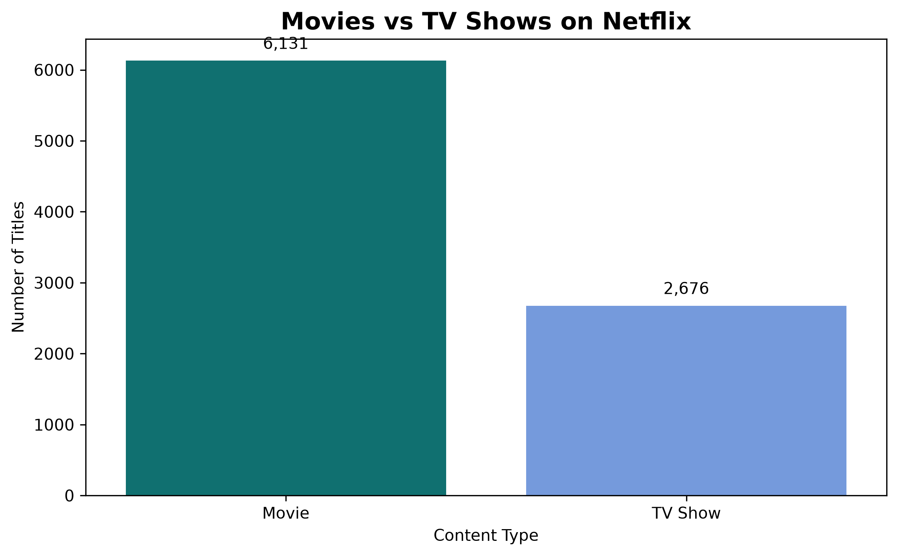
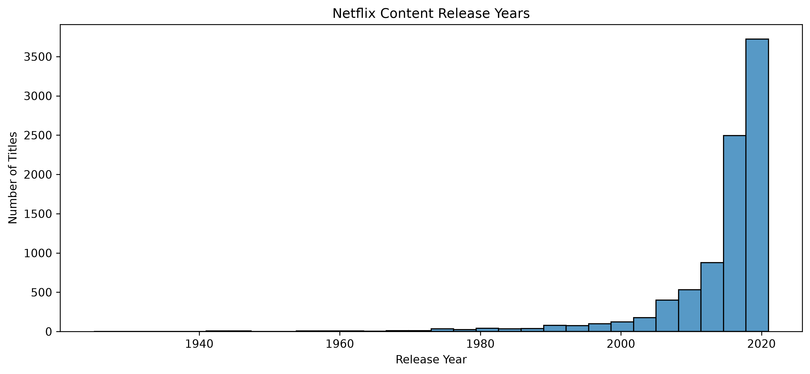
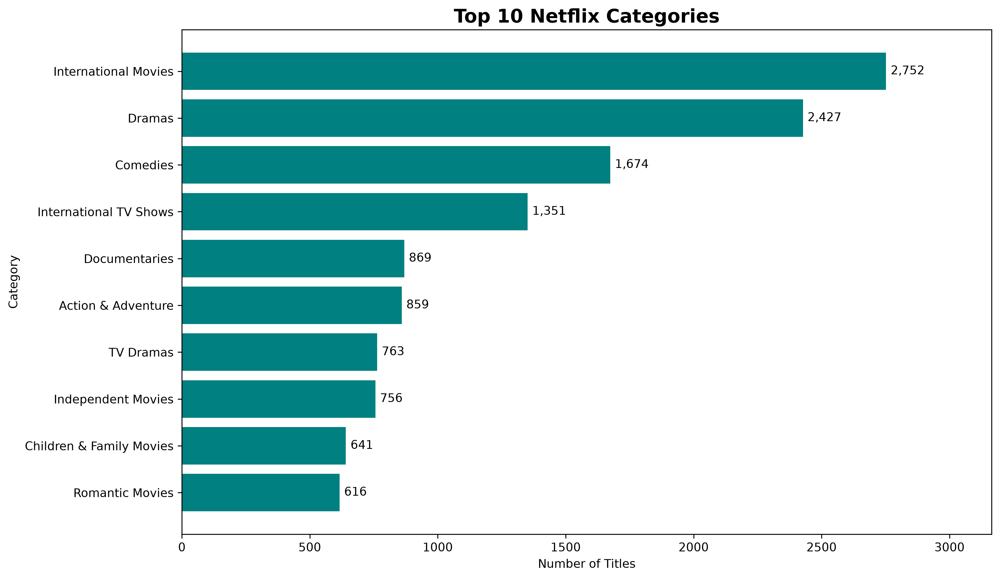
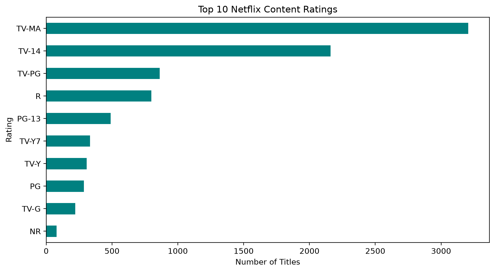
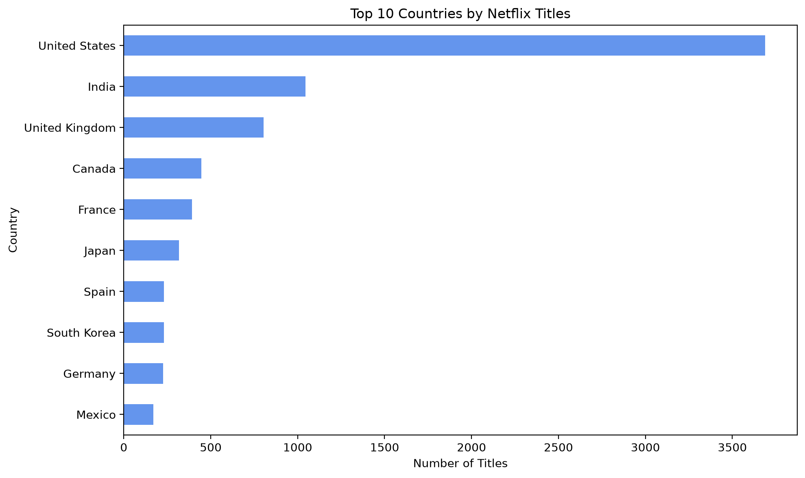
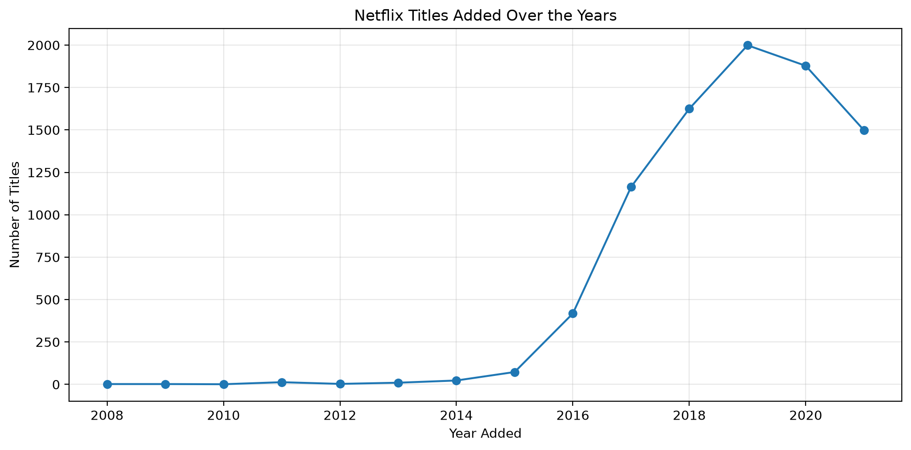
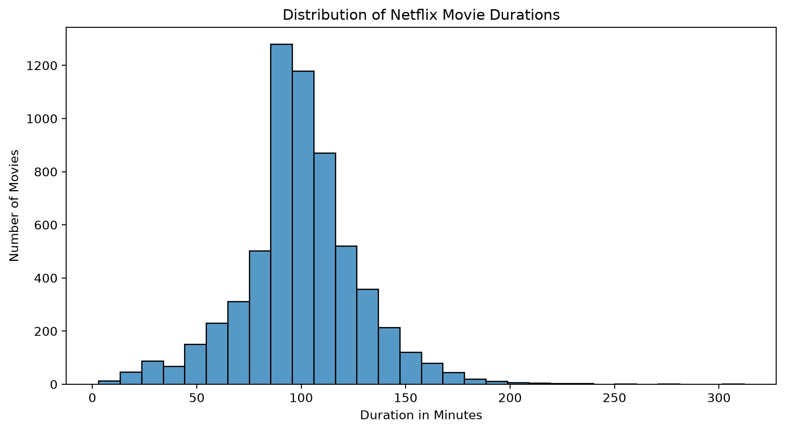

# Netflix Movies & TV Shows Data Analysis

## Project Overview

This project explores Netflix movies and TV shows using Python.
The goal is to understand the dataset, handle missing values,
perform exploratory data analysis (EDA), and discover useful insights.

## Tools and Libraries

- Python
- Pandas
- Matplotlib
- Seaborn
- Jupyter Notebook

## Project Tasks

- Loaded and explored the Netflix dataset.
- Checked rows, columns, and missing values.
- Calculated missing value percentages.
- Checked for duplicate rows.
- Handled missing values in selected columns.
- Compared movies and TV shows.
- Analyzed movie duration and TV show seasons.
- Explored countries, ratings, categories, and years added.
- Created a summary table of key results.

## Key Findings

### Movie Duration

- Movies with available duration data: 6,128
- Average movie duration: 99.58 minutes
- Median movie duration: 98 minutes

### TV Show Seasons

- TV shows with available season data: 2,676
- Median number of seasons: 1
- Most common number of seasons: 1

### Titles Added in 2019

- Total titles added: 1,999
- Movies: 1,424
- TV shows: 575

Movies represented approximately 71.24% of the titles added in 2019,
while TV shows represented approximately 28.76%.

## Data Cleaning

- No complete duplicate rows were found.
- Missing values were identified and their percentages calculated.
- Missing values in director, country, cast, rating, and duration
  were filled with "Unknown" in the cleaned dataset.
- Missing date_added values were left unchanged because the
  original dates were unavailable.

## Project Files

- `netflix_data_visualization.ipynb`: Analysis and visualizations
- `netflix_titles_cleaned.csv`: Cleaned dataset
- `netflix_analysis_summary.csv`: Summary of key results
- `README.md`: Project documentation

## Data Source

[Netflix Movies and TV Shows Dataset](https://huggingface.co/datasets/hugginglearners/netflix-shows)

## Conclusion

This project helped me practice Python, Pandas, data cleaning,
exploratory data analysis, and data visualization.
It also helped me learn how to turn data into meaningful findings.

## Visualizations

### 1. Movies vs TV Shows

